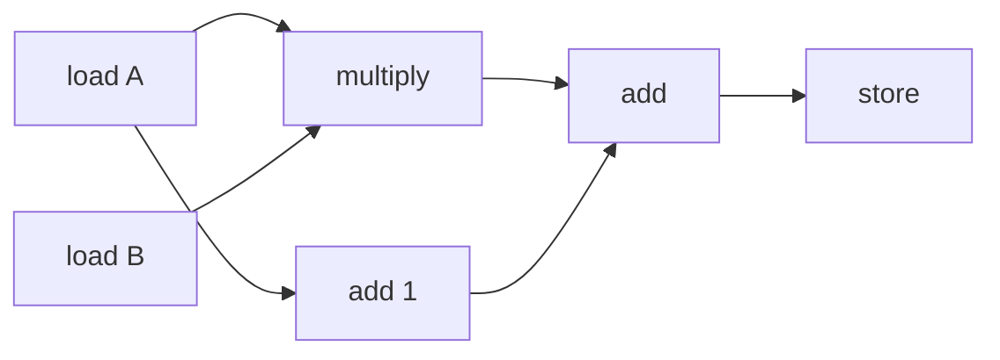

# Multithreaded Algorithms：DAG、Work 与 Span

> [!abstract] 这篇笔记解决什么问题？
> 给定一组有依赖关系的计算任务，先不考虑真实硬件的各种开销：如何描述计算中固有的并行性？有 $P$ 个处理器时，执行时间至少是多少？
>
> 在此基础上，[[Multithreaded Algorithms - Scheduling and Greedy Proof|第二篇笔记]]讨论如何安排任务，以及贪心调度为什么具有近似保证。

## 1. 从程序到计算 DAG

程序按顺序书写，不代表所有操作都必须串行。考虑：

```text
a = load(A)       b = load(B)
c = a * b         d = a + 1
e = c + d
store(C, e)
```

只考虑图示中的数据依赖：两个 load 可以并行；`c` 必须等 `a` 和 `b`；`d` 只需要等 `a`；`e` 必须等 `c` 和 `d`。这形成一个有向无环图（DAG）：



写作 $G=(V,E)$：$V$ 是任务集合；$(u,v)\in E$ 表示 $u$ 必须完成，$v$ 才能开始。实际程序还可能有内存顺序、控制流和副作用约束，不能只凭上图断定任意两条指令可以重排。

### 1.1 依赖与资源是两类约束

- **依赖约束**决定哪些任务必须先后执行，例如 $u\to v$。
- **资源约束**限制同一时刻可以执行多少任务。例如两个互不依赖的乘法共享一个不可流水化乘法器，也不能同时占用它。

拓扑排序给出一种满足依赖的线性顺序，但它本身不指定执行时间和处理器，也不一定带来最短完成时间。调度要在遵守依赖的同时，决定任务何时、在哪里执行。

### 1.2 Fork、Join 与 strand

在 fork-join 程序中，`spawn` / fork 创建可并发的子计算，`sync` / join 等待所需子计算完成。两个分支之间若没有其他依赖，可以同时运行；join 后的操作则必须等待对应分支。

理论分析中常把两个并行控制操作之间的顺序指令序列称为一个 **strand**，并把它当作 DAG 的节点。节点是“不可再被调度器拆分的工作粒度”，不一定等于一个 OS 线程；一个线程或任务运行时可以承载许多 strand。

## 2. 本文使用的理想模型与符号

先建立可推导的模型：

1. 所有任务形成有限 DAG，节点 $v$ 的固定执行时长为 $w(v)>0$。
2. 有 $P\ge1$ 个相同处理器；任意任务都可在任一处理器上执行，且速度相同。
3. 每个任务一次只占用一个处理器，不可拆分或抢占；同一处理器同一时刻最多执行一个任务。
4. 所有任务从时间 0 开始可在其依赖满足后被调度，忽略调度、通信、访存竞争和同步开销。

| 符号 | 含义 |
| --- | --- |
| $w(v)$ | 单个任务 $v$ 的时长；不要与总工作量 $W$ 混淆 |
| $s_v,f_v$ | 任务的开始和完成时间，$f_v=s_v+w(v)$ |
| $P$ | 处理器数量 |
| $W=T_1$ | 全部任务的总工作量；理想单处理器执行时间 |
| $S=T_\infty$ | Span，或关键路径长度；无限处理器下的理想最短时间 |
| $T_P$ | 某个具体合法调度在 $P$ 个处理器上的完成时间 |
| $T_P^*$ | 同一模型和同一 DAG 下的最优完成时间 |
| $C_{\max}$ | Makespan，等于所有任务完成时间的最大值，即 $T_P$ |

对任意依赖边 $u\to v$，合法调度必须满足 $s_v\ge f_u$。没有依赖的任务仍要遵守处理器容量约束。

> [!note] Ready 的含义
> 一个尚未开始的任务在所有前驱都已经完成时称为 **ready**。Ready 意味着依赖允许它开始；当处理器不够时，它仍可能需要等待。

## 3. Work：总共要做多少事？

$$
W=\sum_{v\in V}w(v).
$$

工作量是所有节点耗时的总和，单位可写成“处理器·时间”。单处理器无额外开销地顺序执行所有任务时，所需时间为 $T_1=W$。即使所有任务独立，单处理器也必须把它们逐个做完。

例如 4 个互相独立、各耗时 3 的任务：$W=12$。一个处理器需要 12；四个处理器可并行完成，耗时 3。


W就是T1：只有一个处理器的时候的耗时

### Work bound

在 $P$ 个处理器上运行 $T_P$ 时间，最多提供 $PT_P$ 单位工作。要完成 $W$，必须满足 $PT_P\ge W$，因此：

$$
\boxed{T_P\ge \frac{W}{P}}.
$$

这个下界只考虑处理器总容量，没有利用任务依赖。

## 4. Span：依赖链有多长？

一条路径 $\pi$ 的长度是该路径上节点执行时间之和。Span 是所有有向路径中最长的长度：

$$
S=\max_{\pi\text{ 是 }G\text{ 的路径}}\sum_{v\in\pi}w(v).
$$

路径上的任务必须依次完成，所以任意合法调度都满足 $T_P\ge S$。反过来，若处理器无限且没有其他开销，每个任务在所有前驱完成后立即开始，整个 DAG 恰好可以在 $S$ 内完成，即 $T_\infty=S$。

例如 $A\to B\to C\to D$，各耗时 5，链长为 20。即使增加处理器，也不能把它缩短到 20 以下。

### 4.1 如何计算 DAG 最长路径？

定义 $L(v)$ 为无限处理器模型下，从源点到 **完成** $v$ 的最长路径长度：

$$
L(v)=w(v)+\max_{u\in\operatorname{Pred}(v)}L(u),
\qquad S=\max_{v\in V}L(v).
$$

没有前驱时，空集合上的最大值按 0 处理。按拓扑序遍历所有节点，每条边只处理常数次，时间复杂度为 $O(|V|+|E|)$。这是 [[Dynamic Programming(动态规划)|DAG 上的动态规划]]。

**拓扑排序复习：** Kahn 算法维护入度为 0 的节点；移除一个节点后，将其后继的入度减一，新变为 0 的节点加入队列。如果处理结束后仍有未移除节点，图中存在环。

这里的“移除”是图算法中的逻辑操作；实际执行时要等任务完成，才能减少后继的未完成前驱数。

### 4.2 一个例子

设 $A\to B$、$A\to C$、$B\to D$、$C\to D$、$D\to E$，各节点时长分别为 $2,4,3,2,1$：

| 节点 | $L(v)$ | 计算 |
| --- | --- | --- |
| A | 2 | 2 |
| B | 6 | $2+4$ |
| C | 5 | $2+3$ |
| D | 8 | $\max(6,5)+2$ |
| E | 9 | $8+1$ |

因此 $S=9$，一条关键路径是 $A\to B\to D\to E$；总工作量是 $W=2+4+3+2+1=12$。关键路径可能有多条，不能把任意一条以外的任务理解为不重要。

## 5. 两个下界一起看：Work-Span Law

任意合法调度，包括最优调度，都满足：

$$
\boxed{T_P\ge T_P^*\ge\max\left(\frac{W}{P},S\right)}.
$$

- $W/P$ 对应资源总量约束。
- $S$ 对应依赖链约束。

如果 $W=100$、$S=30$、$P=4$，那么 $T_4^*\ge\max(25,30)=30$。但这**不能证明存在 30 时间完成的调度**：两个下界都是必要条件，任务的具体结构和不可拆分性可能使最优时间更长。

## 6. Speedup 与 Parallelism

对某个 $P$ 处理器调度，定义相对于理想单处理器的加速比：

$$
\operatorname{Speedup}(P)=\frac{T_1}{T_P}=\frac{W}{T_P}.
$$

利用两个下界可得：

$$
\operatorname{Speedup}(P)\le P,
\qquad
\operatorname{Speedup}(P)\le\frac{W}{S}.
$$

因此：

$$
\operatorname{Speedup}(P)\le\min\left(P,\frac{W}{S}\right).
$$

$W/S$ 称为算法的**理论并行度**（average parallelism），是理想单处理器工作量与无限处理器时间之比，也是理想加速比上界。它不是每一时刻的 ready 任务数，也不保证任意 $P\le W/S$ 时都能达到线性加速。

效率常定义为 $E_P=\operatorname{Speedup}(P)/P$。当 $P$ 远大于 $W/S$，即使忽略开销，依赖也会使很多处理器无法持续忙碌。

## 7. 实际硬件对应什么？

| 系统 | 节点可对应 | 资源可对应 | 与理想模型的差异 |
| --- | --- | --- | --- |
| OoO CPU | uop | 执行端口、功能单元 | 有限指令窗口、资源类型和内存依赖 |
| 编译器 | 指令或 IR 操作 | 功能单元、寄存器 | 编译时依据估计延迟和机器模型安排 |
| 并行运行时 | task / strand | worker | 任务创建、调度与同步有开销 |
| NPU | DMA、矩阵或向量任务 | DMA、Matrix、Vector 引擎 | 异构资源、带宽与有限 buffer |

尤其注意：指令的**延迟**不一定等于功能单元的**占用间隔**。一个延迟为 4 cycles 的流水化乘法器，可能每 cycle 都能接收一条新指令；因此，不能简单用 4 cycles 独占处理器的模型直接推导其吞吐量。

当各类任务只能使用对应的独立、同速资源，且工作量与处理能力单位一致时，可以分别建立资源容量下界：

$$
T\ge\max\left(S,\frac{W_{\mathrm{matrix}}}{P_{\mathrm{matrix}}},
\frac{W_{\mathrm{DMA}}}{P_{\mathrm{DMA}}},
\frac{W_{\mathrm{vector}}}{P_{\mathrm{vector}}}\right).
$$

这仍只是下界，还需要考虑带宽共享、SRAM 容量、buffer 生命周期和调度开销。相关背景可联系 [[Matrix Engine]]、[[Tiling]]、[[并发与内存带宽]]。

## 8. 自测

1. 一组互相独立的任务为什么仍有 $W/P$ 下界？
2. 为什么关键路径是最长路径，而不是最短路径？
3. $W/S$ 与某个时刻的 ready 任务数量有什么区别？
4. 知道 $W$、$S$、$P$，为什么通常不能直接求出 $T_P^*$？
5. 任务 ready 但未执行，一定是调度器出了错吗？

下一篇：[[Multithreaded Algorithms - Scheduling and Greedy Proof]]。

---

整理依据：[动态调度理论学习讨论](https://chatgpt.com/share/6af572ed-fea4-83ea-b66d-427fe4ac75a3)。
