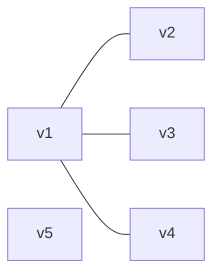

# Register Allocation（寄存器分配）

> [!abstract] 核心问题
> 编译器可以产生大量虚拟寄存器，但目标机器可用的寄存器有限。寄存器分配要决定：**每个值放在哪里，哪些值能复用同一寄存器，不够时怎样改写程序以降低成本？**

本文按“活跃性分析 → 冲突图 → 图着色 → 溢出与改写”的顺序学习，再结合讨论中的 CSP／AC-3 联想理解算法。后半段讨论到的 software pipelining、VLIW 等调度内容另属一个主题，这里只保留它们与寄存器压力的联系。

## 1. 虚拟寄存器很多，为什么不需要同样多的机器寄存器？

考虑下面的中间代码，每个 v 表示保存一个值的虚拟寄存器：

```text
1  v1 = 10
2  v2 = 20
3  v3 = v1 + v2
4  v4 = v3 * 2
5  v5 = v1 + v4
6  return v5
```

v2 在指令 3 被读取后不再需要，它占用的寄存器可以被 v3 接着使用。v3 最后一次被指令 4 读取，之后也可以把寄存器交给 v4。

因此关键不是程序总共定义多少个值，而是哪些值需要同时保留、不能互相覆盖。即使两个变量的名字不同，只要保存各自值的时间不冲突，就可能共用一个寄存器。

这里先假设同一寄存器类有 R 个等价、互不重叠的可用寄存器，普通运算允许目的寄存器与源寄存器相同；忽略调用约定等额外约束。后文再说明这个模型的限制。

## 2. Liveness：当前这个值未来还需要吗？

一个值在程序位置 p 是 **live（活跃）** 的，如果从 p 出发，存在一条后续控制流路径，会在它被覆盖之前读取这个值。

“存在一条路径”即可，不要求所有后续路径都使用它。这是一种对可能用途的分析：不能只因为当前预测的分支不用，就提前覆盖仍可能被另一分支读取的值。

### 2.1 逐条看例子中的活跃集合

| 指令 | 执行后的 live-out | 原因 |
| --- | --- | --- |
| `v1 = 10` | {v1} | v1 后面还会用 |
| `v2 = 20` | {v1, v2} | 两者都将被指令 3 使用 |
| `v3 = v1 + v2` | {v1, v3} | v2 已完成最后一次使用，v1 还要供指令 5 使用 |
| `v4 = v3 * 2` | {v1, v4} | v3 已完成最后一次使用 |
| `v5 = v1 + v4` | {v5} | v1、v4 都不再需要 |
| `return v5` | ∅ | 当前计算结束 |

在这个直线程序及上述机器假设下，最多两个值需要同时保留，两枚寄存器就足够：

| 虚拟寄存器 | 分配结果 |
| --- | --- |
| v1 | r1 |
| v2、v3、v4 | r2 |
| v5 | r1 |

```text
r1 = 10
r2 = 20
r2 = r1 + r2
r2 = r2 * 2
r1 = r1 + r2
return r1
```

指令 `r2 = r1 + r2` 先使用旧 r2，再以结果覆盖它。v2 的最后使用与 v3 的定义发生在这条指令中，并不意味着它们必须同时占用两个不同的目的位置；能否这样复用要检查目标指令约束。

例子使用常数是为了方便观察生命周期，暂不进行常量折叠等其他优化。两种代码都返回 70。

### 2.2 从直线程序推广到 CFG

CFG（Control Flow Graph，控制流图）的节点通常是基本块，边表示可能的控制转移。基本块内是一段顺序执行的指令。

对基本块 B 定义：

| 集合 | 含义 |
| --- | --- |
| $\mathrm{USE}[B]$ | 块内在首次定义该变量之前，就会读取其进入块时的值的变量 |
| $\mathrm{DEF}[B]$ | 块内定义的变量 |
| $\mathrm{IN}[B]$ | 进入 B 前活跃的变量 |
| $\mathrm{OUT}[B]$ | 离开 B 后活跃的变量 |

数据流方程为：

$$
\boxed{\mathrm{OUT}[B]=\bigcup_{S\in\mathrm{Succ}(B)}\mathrm{IN}[S]}
$$

$$
\boxed{\mathrm{IN}[B]=\mathrm{USE}[B]\cup
\bigl(\mathrm{OUT}[B]\setminus\mathrm{DEF}[B]\bigr)}.
$$

第一式：任一后继可能需要的值，都必须保留到当前块出口。第二式：进入块时要有的值，包括本块自己先读的值，以及后继需要且没有被本块定义替换的值。

它是**逆向数据流分析**。从空集合开始反复更新 IN/OUT，有限变量集合上的单调更新最终会稳定，得到标准方程的最小不动点。

例如两个基本块构成循环：B1 只定义 x 并转到 B2；B2 使用 x 后可能回到 B1，也可能退出。B2 的 IN 包含 x，传播后 B1 的 OUT 包含 x；但 B1 重新定义了 x，故不要求旧 x 在 B1 入口活跃。

可以用同样的规则在块内逆序逐条计算活跃集。完整实现还需处理 SSA 的 φ 输入等边上的使用；这里先学习基础方程。

> [!note] 与动态规划的联系
> 这里也在图上定义状态与传递方程，但 CFG 可以有环，通常需要不动点迭代，不能直接当成 [[Dynamic Programming(动态规划)|DAG 上按拓扑序计算一次的 DP]]。

## 3. Interference Graph：哪些值不能共享寄存器？

构造无向冲突图 $G=(V,E)$：每个节点是待分配的虚拟寄存器或 live range；一条边表示这两个对象不能分配到同一个寄存器。

在当前简化模型中，两个不同值若需要同时保留，就会冲突。构造时可逆序扫描指令，把定义的目的值与该指令之后仍活跃的其他值连边；复制指令、固定寄存器等情形需要专门处理。

上例的正确边集为：

$$
E=\{(v1,v2),(v1,v3),(v1,v4)\}.
$$



v5 是孤立节点，可以复用 r1；v2、v3、v4 之间没有冲突，可以共享 r2。

> [!important] 原讨论中的冲突边纠正
> v3 与 v5 不应连边。定义 v5 之前，v3 早已完成最后一次使用；两者生命周期没有重叠。不能因为两个值出现在同一段代码里，就认为它们冲突。

### 3.1 依赖图与冲突图的边，含义不同

| 图 | 边表示什么 | 解决什么问题 |
| --- | --- | --- |
| 指令依赖 DAG | $u\to v$：v 要等待 u 的结果或满足其他顺序约束 | 哪些操作可以重排、并行执行 |
| 寄存器冲突图 | $u-v$：二者不能占同一个寄存器 | 哪些值能够复用资源 |

依赖与冲突不能混用。例如 v2 被用于计算 v3，二者有定义—使用依赖，却仍可在最后使用处复用同一寄存器。可对照 [[Multithreaded Algorithms - Scheduling and Greedy Proof|DAG 调度笔记]]理解两类图的不同语义。

## 4. 把寄存器分配建模为图着色

有 R 个等价可用寄存器，就用 R 种颜色给节点着色，要求相邻节点颜色不同：

$$
f:V\to\{r_1,\ldots,r_R\},\qquad
(u,v)\in E\Rightarrow f(u)\ne f(v).
$$

同色表示共用一个寄存器。上例的星形图可二着色，正好对应前面的分配。

### 4.1 三个值两两冲突时，两个寄存器不够

若 a、b、c 两两冲突，就形成三角形。先令 a 使用 r1，b 就要使用 r2，而 c 同时与二者冲突，没有颜色可选。因此该图至少需要三个颜色。

更一般地，大小为 q 的团（clique，任意两节点都有边）至少需要 q 个颜色。一个程序点同时保留 q 个互不相同、不能共享位置的值，也给出寄存器需求下界。

但一般冲突图中，“最大同时活跃数”或“最大团大小”并不总能直接给出可着色所需的精确颜色数，也不能忽略机器约束。上例中两个寄存器足够，是已经构造出合法分配后得到的结论。

### 4.2 为什么需要启发式？

对一般图，固定 $R\ge3$ 时，判定 R 可着色是 NP-complete 问题。工程上通常不会对任意大冲突图进行完整组合搜索，而是利用图结构和成本启发式。

这里讨论的是一般图着色模型的难度；不能由此认为所有程序形式、所有受限模型都同样困难。实际寄存器分配还允许改写程序，并包含寄存器类、指令和调用约束，目标也不只是回答“能否着色”。

## 5. 经典思路：Simplify → Select → Spill

### 5.1 为什么可以先移除度数小于 R 的节点？

若某节点在**当前剩余图**中的度数满足 $\deg(v)<R$，则假定剩余图已经合法着色，恢复 v 时最多有 $R-1$ 个邻居。它们最多禁用 $R-1$ 种颜色，所以 v 一定还有可用颜色。

这证明的是一个**条件性扩展保证**：只要剩余图能着色，就可以把 v 放回去。它并未保证剩余图本身一定可着色。

### 5.2 算法过程

1. **Simplify**：在剩余图中选度数小于 R 的节点，移除并压栈；邻居度数随之下降。
2. **Potential spill**：若找不到这种节点，按成本等启发式选一个节点，标为潜在溢出候选后暂时移除。
3. 重复直到图被移空。
4. **Select**：逆序出栈，给节点选一个未被已着色邻居占用的寄存器。
5. 若某节点确实没有可用位置，才发生实际 spill 或进一步拆分；改写程序后重新分析相关活跃性并分配。

对上例，R=2。可以先移除 v5、v2、v3、v4，再移除 v1；恢复时给 v1 选 r1，v4、v3、v2 都选 r2，v5 可选 r1。

### 5.3 “度数至少 R”不等于“必须 spill”

度数只给出充分保证。R=2 时，一个四边形的每个节点度数都为 2，简化规则一开始无法使用，但图显然可用两色交替着色。相比之下，三角形同样每个节点度数为 2，却不能二着色。

所以高度数节点只是失去了简单保证，可以暂时移除后乐观尝试恢复，不能一看到 $\deg(v)\ge R$ 就断言无解。

该度数规则假设所有节点拥有相同 R 个互不别名的寄存器。允许集合不同、寄存器重叠时，需要更细的可分配性判定。

## 6. 与 CSP、AC-3 的联系

> [!question] 图着色算法，为什么让我想到 CSP 和 AC-3？

这个联系是直接的。把图着色写成 Constraint Satisfaction Problem（约束满足问题）：

| CSP 对象 | 寄存器分配中的对应物 |
| --- | --- |
| 变量 $X_v$ | 某个待分配值的位置 |
| 域 $D_v$ | 它允许使用的寄存器集合 |
| 约束 | 冲突边要求 $X_u\ne X_v$ |

普通 R 着色中，每个变量的域都是 $\{r_1,\ldots,r_R\}$；真实机器约束可让不同变量拥有不同的域。

### 6.1 弧一致性究竟保证了什么？

对有向约束弧 $X_u\to X_v$，弧一致性要求：

$$
\forall a\in D_u,\quad\exists b\in D_v:\ C_{uv}(a,b).
$$

也就是 u 的每个候选值，都能在 v 的域中找到至少一个局部支持。找不到支持的候选值可以安全删除；AC-3 通过反复修订相关弧，把域变化继续传播。

对于不等约束，只要邻居的域至少有两个不同颜色，u 的任意颜色都能找到一个不同的邻居颜色，因此这条弧不会删掉 u 的候选值。普通对称图着色初始时往往因此没有明显删减。

### 6.2 两色三角形：局部一致，整体仍无解

令三角形 a、b、c 的域都是 $\{r1,r2\}$。每条边单独看都能满足不等约束：一个端点选 r1，另一个可以选 r2，反过来也成立。

所以初始 AC-3 不会删除任何候选值；但三角形整体不可二着色。原因是每条边所找到的局部支持，不保证能够组合成同一个全局赋值：

$$
\boxed{\text{Arc consistency}\ \not\Rightarrow\ \text{存在全局解}}.
$$

若在搜索中先试 $a=r1$，则 b、c 都必须变成 r2，随后边 $b\ne c$ 使域变空。AC-3 可以发现这次分支失败，但它不等同于一开始就完成全局搜索。

### 6.3 与 Simplify 有什么区别？

| 方法 | 缩小什么 | 推理保证 |
| --- | --- | --- |
| AC-3 | 候选域 | 删除没有局部支持的取值 |
| 图着色 Simplify | 剩余变量与图 | 剩余图若有解，低度节点可安全恢复 |

AC-3 可以配合回溯形成完整 CSP 求解；经典着色分配器通常采用图简化、乐观着色与 spill 启发式，避免一般的完整搜索。两者都是约束推理，但不是同一套操作。

若有固定寄存器等约束，域传播会更有帮助。例如 a 与 b 冲突，$D_a=\{r1\}$、$D_b=\{r1,r2\}$，即可删掉 b 的 r1 候选。若 b 又与 $D_c=\{r2,r3\}$ 的 c 冲突，则可进一步使 c 只剩 r3。

### 6.4 只有两个颜色时，还能更直接

对于纯粹的两色冲突图判定，可以用 BFS 或 DFS 交替标色，检测是否存在同色相邻节点，即判断图是否二分。时间为 $O(|V|+|E|)$。

这是针对**固定冲突图、无 spill、无其他机器约束**的精确判定。它不直接解决应该溢出哪个值、怎样拆分、怎样满足复杂寄存器约束等优化问题。

## 7. 寄存器不够时，能“新增 reg”吗？

> [!question] 本质是图着色，溢出时就新增寄存器或放到内存，这部分是不是结束了？

编译器可以继续创建虚拟寄存器，但不能凭空增加目标机器提供的寄存器。创建更多名字不会增加容量；要减少某个位置必须同时放在寄存器中的值，或改变它们的位置安排。

### 7.1 Spilling：把一部分保存责任交给内存

Spill 通常把值暂存到栈槽，需要使用时再 reload。例如某个值 v 在较长区间内不用，可以概念性地改写为：

```text
... 产生 v ...
store [spill_slot], v
... 在不需要 v 的区间里复用寄存器 ...
tmp = load [spill_slot]
... 使用 tmp ...
```

寄存器压力降低的代价是访存、地址生成和新增指令。Reload 得到的临时值仍然需要寄存器，所以 spill 不只是从旧图删除一个节点；它会改写程序并改变 live range，需要重新分析。

选择 spill 候选时应考虑使用频率、循环位置、保存与重载次数、值的宽度等。一个循环内每轮使用的值，通常比仅在冷路径使用的值更不适合反复 spill；仅按节点度数选择并不足够。

### 7.2 Live Range Splitting：不用全程占同一个位置

可以把一个值的活跃范围拆成多个区间，不同区间使用不同寄存器，或只在寄存器压力高的中间一段放到内存。区间交界需要必要的复制、保存或重载，保证值仍然正确。

这比“整个生命周期只选一个颜色”更灵活，但也会增加位置转换与分析复杂度。

### 7.3 Rematerialization：便宜的值可以重新算

像简单常数或某些便宜且可安全重复的表达式，可以在使用前重新产生，而不一定先存内存再读回来。是否值得取决于运算成本、使用频率与目标指令支持。

不是所有表达式都能安全重算：有副作用、依赖变化状态或语义要求不允许的操作，需要另外检查。

## 8. 超出基础着色模型的几个重要概念

### 8.1 Coalescing：让复制两端共用寄存器

```text
v2 = v1
use(v2)
```

如果两端能够合法放在同一寄存器，复制就可被消除。合并 live range 对应图节点时，邻居集合也会合并，可能增加着色难度；因此减少 move 与避免 spill 之间需要权衡。

复制还有一个细节：两份名字若明确代表同一个值，即使名字的活跃范围有重叠，也不能机械地据此断言它们必须占不同位置。实际冲突构造与保守合并规则会考虑 move 语义。

### 8.2 Linear Scan：分配器不一定显式构造通用冲突图

线性扫描按程序位置组织 live interval，扫描到新区间时释放已经结束的区间，将可用寄存器交给新值；资源不够时选择溢出或拆分。它以较低的分配开销见长。

控制流会带来活跃区间的空洞和多个段，因此工程实现比“按区间起点排序一次”更丰富。图着色和线性扫描是不同的实现思路；不能把寄存器分配定义为必须运行某种图着色算法。

### 8.3 机器约束让颜色不再完全等价

实际需要考虑的因素包括：

- 不同寄存器类，例如整数、浮点与向量寄存器。
- 某条指令要求固定寄存器，或要求目的与某个源使用同一位置。
- 寄存器别名、子寄存器和成组寄存器要求。
- 调用约定与 call 会破坏哪些寄存器，以及保存、恢复成本。

它们可能改变候选域、冲突关系或成本。这也是从基础图着色模型走向实际分配器时还需要学习的内容。

## 9. 与硬件重命名、指令调度的联系

### 9.1 编译器分配与硬件 Register Renaming

“物理寄存器”在编译器与微架构语境中可能指不同层次。编译器后端通常把虚拟寄存器落实为目标 ISA 可命名的机器寄存器；OoO 处理器运行时还可能把这些架构寄存器映射到内部更大的物理寄存器文件。

| 方面 | 编译器寄存器分配 | 硬件寄存器重命名 |
| --- | --- | --- |
| 时机 | 编译时 | 程序运行时 |
| 主要映射 | 虚拟值 → 机器寄存器或内存位置 | 架构寄存器的不同动态版本 → 内部物理寄存器 |
| 主要作用 | 有限 ISA 寄存器的复用与 spill 成本控制 | 消除名字复用导致的 WAR/WAW 假相关，支持乱序执行 |

硬件重命名保留 RAW 真依赖，也不会自动撤销编译器已经生成的 spill load/store；内部物理寄存器更多，不等于编译器能额外使用同样多的 ISA 寄存器名字。

### 9.2 调度会改变寄存器压力

把多个独立 load 提前，可能更好地隐藏延迟，却也使其结果更早产生、更晚使用，延长 live range。循环展开或跨迭代重叠还可能增加同时在途的值。

因此，指令调度与寄存器分配互相制约：更高的并行性可能换来更高的寄存器压力，spill 又会新增访存与依赖。可联系 [[Multithreaded Algorithms - Scheduling and Greedy Proof]] 与 [[Tiling]] 中“复用收益受有限存储约束”的视角，但它们管理的资源与粒度不同。

## 10. 复习时检查这几个问题

1. 为什么 v2 与 v3 可以共用寄存器，而 v1 与 v3 不可以？
2. 为什么活跃性需要对后继取并集？CFG 有环时怎样求解？
3. v3 与 v5 为什么没有冲突边？依赖边与冲突边有什么区别？
4. $\deg(v)<R$ 保证了什么？四边形为什么说明反过来不成立？
5. 两色三角形为什么初始满足弧一致性却没有全局解？
6. Spill 为什么需要改写程序并重新分析，而不只是删掉图节点？
7. 创建更多虚拟寄存器、硬件重命名与增加 ISA 可用寄存器为什么是不同的事？

基础主线是 **Liveness → Interference → Allocation → 必要的程序改写**。图着色提供经典模型，CSP 提供另一个约束视角；进一步学习可以展开 spill 成本、区间拆分、合并与实际机器约束。

---

整理依据：[学习寄存器分配讨论](https://chatgpt.com/share/6af6b626-80a8-83e9-a388-f6b2b39a63f6)。本文保留了原讨论的活跃集与分配例子，修正冲突边，并在对应位置整合 CSP／AC-3 联想及“新增寄存器”的追问。
