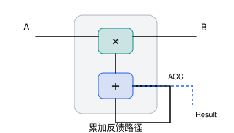
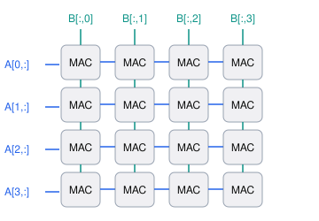

https://chatgpt.com/c/6add979e-8bdc-83e9-83ae-616dc62b370a

最底层元素是[[MAC]] （multiply-accumulate）


对于最底层的k-axis reduce，我们有
```python
acc = 0

for k in range(K):
    acc += A[i][k] * B[k][j]

C[i][j] = acc
```
可以用简单的mac单元来解决



### 二维PE Array


对于 \(4\times4\) 的结果矩阵，16 个 PE 可以分别负责：

\[ \begin{bmatrix} C_{00}&C_{01}&C_{02}&C_{03}\\ C_{10}&C_{11}&C_{12}&C_{13}\\ C_{20}&C_{21}&C_{22}&C_{23} \end{bmatrix}_{\text{（示意，实际为4行）}} \]

于是，第 \((i,j)\) 个 PE 就负责：

\[ PE_{ij}:\quad acc_{ij} \mathrel{+}=A_{ik}B_{kj} \]

当所有 PE 都在稳定工作时，一个时钟周期可以完成 16 次 MAC，也就是按常见 FLOPs 口径计算的 32 次浮点运算（假设使用浮点乘加）。